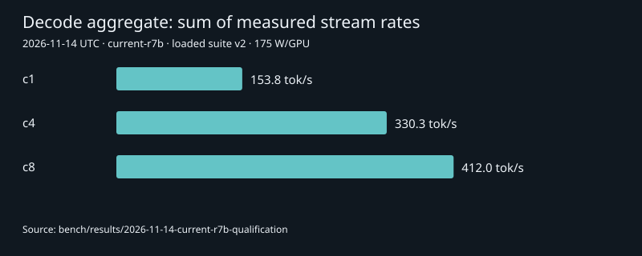

# DeepSeek-V4.1-Flash on 4x CMP 170HX

Serving configuration, patch series, runtime overlays and measurements for [DeepSeek-V4.1-Flash-1017](https://huggingface.co/deepseek-ai/DeepSeek-V4.1-Flash-1017) on four NVIDIA CMP 170HX cards (GA100, `sm_80`, 64 GB each after the memory unlock). The single-socket host has an EPYC 7401P, 46 GB of RAM and NVMe-backed Engram tables. All four cards use PCIe Gen2 x16 links and a 175 W cap per card. Tensor parallelism spans all four GPUs.

The current serving definition is **current-r7b**, promoted on 2026-11-14 at 09:40 UTC (10:40 Paris). It combines the vLLM nightly `df3bd094` engine, EXL3 EAQ v1.1 2.9 bpw routed experts, the official FP8/MXFP4 components, DSpark K5 and the cumulative fixed640 cooperative MoE kernel. The raw model is `deepseek-v4.1-flash-1017`; a per-request rank-one `wo_b` adapter exposes `deepseek-v4.1-flash-1017-abliterated`. Weights and adapters are not included.

This local publication preparation records the serving state from retained evidence. [Reproduction](docs/REPRODUCING.md) identifies the remaining source and model-pin gaps. The exported launcher prints a plan without contacting Docker by default and refuses execution while those gaps remain unresolved.

## Numbers

Measured on **2026-11-14, 05:21–07:02 UTC**, using the current-r7b ON arms of the loaded v2 qualification, results directory `rounds/current-r7b-r1/out/20261114T052150Z-2097332-qualify`. Both ON boots use the configuration below, four Gen2 x16 links and 175 W per card. [Results and derivation](bench/results/2026-11-14-current-r7b-qualification/NOTES.md), [machine-readable summary](bench/results/2026-11-14-current-r7b-qualification/summary.json).

| workload | concurrency | output per request | decode aggregate, tok/s | two boot rates, tok/s |
| --- | ---: | ---: | ---: | --- |
| frozen chat prompts, mostly reasoning prose before code | 4 | 400 | **330.3** | 334.66 / 325.98 |
| same workload | 8 | 400 | **412.0** | 415.56 / 408.43 |
| same workload | 1 | 400 | **153.8** | 154.35 / 153.20 |

Decode uses `decode-prompts-v2`, temperature zero, seed 15 and EOS suppression. Each value is the mean of two boot rates. Each batch sums the measured request decode rates, `(completion_tokens - 1) / (stream_end - first_content_event)`, then each boot averages its scored batches. The published value averages the two boot means. No per-stream rate is inferred from the aggregate; individual stream statistics are absent from the supplied summary. These measurements do not quantify sampled agent traffic at temperature one or the abliterated variant.

| cold input tokens per request | concurrency | TTFT, s | recorded input rate, tok/s |
| --- | ---: | ---: | ---: |
| 2,048 | 1 | 0.749 | 2,738 |
| 2,048 | 4 | 2.187 | 3,113 |
| 2,048 | 8 | 3.297 | 3,352 |
| 8,192 | 1 | 2.355 | 3,480 |
| 8,192 | 4 | 6.103 | 3,629 |
| 8,192 | 8 | 10.476 | 3,686 |

Prefill comes from the same date, configuration and qualification directory: median scored batches b0–b2 per boot, then mean over the two ON boots. The input rate is transcribed separately from TTFT. The frozen prefill instrument uses temperature zero, thinking off, EOS suppression and one output token. Each point has one unscored warm batch and three scored batches; prompt-cache hits must be zero. The host page cache remains warm-steady and is not dropped. Nominal text lengths are calibrated before the chat template; the actual template overhead and per-request token counts are absent from the supplied summary. TTFT includes the request path and is not pure GPU kernel time. [Conditions](bench/results/2026-11-14-current-r7b-qualification/NOTES.md).

## Served configuration

| item | current-r7b |
| --- | --- |
| runtime | vLLM `df3bd094aeea829f27baa0a5282830464f601d9f`, installed image ID `sha256:f760136967d6c4cac9f4de317e2b9a19a170d27519ddeb0ba9aad3e420ec3c27` |
| weights | EAQ v1.1 EXL3 2.9 bpw routed experts; official attention, shared experts, head, draft and Engram components |
| parallelism | TP4, PP1; four CMP 170HX cards |
| power and bus | 175 W per GPU; PCIe Gen2 x16 on each GPU |
| Engram | NVMe row reads, fused dequantization, early prefetch and bounded host row cache |
| request window | 262,144 tokens configured; no current maximum-depth performance claim |
| scheduling | eight sequences; 2,048 batched tokens; async scheduling and prefix caching |
| graphs | FULL_DECODE_ONLY; capture sizes every integer from 1 through 48; LoRA specialization disabled |
| speculation | DSpark maximum five draft tokens; adaptive verification disabled; calibrated row-mask features only through batch one |
| KV | `fp8_ds_mla`; FP8 indexer; configured capacity is not a current measured pool-size claim |
| attention | tuned BF16x2 split-K table, fused SWA metadata and top-k glue |
| communication | true ring at the r7 row list; existing INT8 prefill reduction; replicated Engram wkv |
| MoE | fused dispatch preparation and cumulative fixed640 native cooperative kernel |
| API | DeepSeek tokenizer, tool and reasoning parsers; raw default plus the per-request abliterated name |
| chat | earlier reasoning preserved with `drop_thinking=false`; image count limit 999 |
| host | GPU workers pinned to their card's local CPUs; engine/API affinity retained |
| other policies | fair prefill and prompt lookup disabled; client sampling defaults unchanged |

## What the stack is

The base is the r17 image kit: SM80 sparse attention, SSD Engram storage, EXL3 integration and tensor-core prefill support on the pinned nightly. The installed f760 image contains later layers; rebuilding the r17 kit alone does not reproduce f760. [Patch series](docs/PATCHES.md) gives the order, purpose, target files and base for each exported patch. [Third-party inputs](THIRD_PARTY.md) records commits, licences and unresolved pins.

The current runtime adds the split-K precision table, cap-1 calibrated depth bridge, target and draft sharded argmax, attention metadata fusions, lean row statistics, replicated wkv, fused dispatch and the expanded true-ring row list. The r7a plugin binds the dense rank-one update per request and replaces the older draft/audit plugin registration while importing its implementation. R7b changes only the native cooperative asset directory. [Overlay inventory](docs/SOURCE-INVENTORY.json) records exported source hashes.

## Reproducing

Start with [docs/REPRODUCING.md](docs/REPRODUCING.md), the parameterized [host environment example](scripts/host.env.example), [serving plan](config/served.json) and [launcher](scripts/serve.sh). `bash scripts/serve.sh --print` is local plan rendering. A complete Linux image build, native compile and GPU acceptance have not been run for this export. The public source package still needs the explicitly listed runtime assets and full checkpoint/adapter provenance before it can reproduce a serving boot.

## Measurement limits

The qualification table above covers only the current configuration's frozen greedy decode and six prefill cells. Current sampled temperature-one agent throughput, per-stream TPOT, decode sums over a shared overlap window, standard public benchmark scores, sustained mixed prefill/decode, long-context speed, maximum KV capacity, wall power and abliterated-model performance have not been established by these records. Older October measurements remain under `bench/results/` and describe their own configurations.

The 2026-11-14 actual-launcher acceptance passed at 09:26–09:37 UTC, source `rounds/current-r7b-r1/out/20261114T092653Z-4010770-actual-acceptance`; it checked both served names and token identity against the four qualification boots. The operating record reports matching logprob bits and shapes for this acceptance, while the gate itself uses token identity because raw c8 has an incumbent bimodal case. Loopback acceptance does not establish client-network reachability. PCIe correctable replays were present in the recorded hardware state.

The [partial per-operation profile](bench/results/2026-11-14-current-r7b-profile/NOTES.md), dated 2026-11-14, has forced c4 K3 / c8 K2 / c1 K5 shapes. It is diagnostic evidence from a separate boot. [History](docs/HISTORY.md) and [instrument notes](docs/GOTCHAS.md) retain earlier context. Charts regenerate with `python3 bench/plot.py`; the original recipe uses MIT and third-party components retain the notices in [NOTICE](NOTICE) and [THIRD_PARTY.md](THIRD_PARTY.md).
