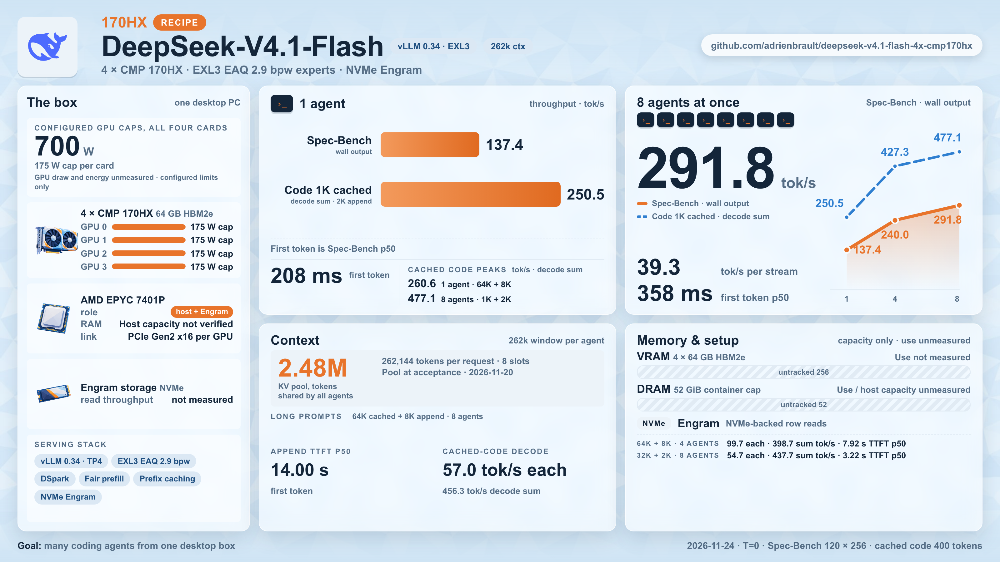
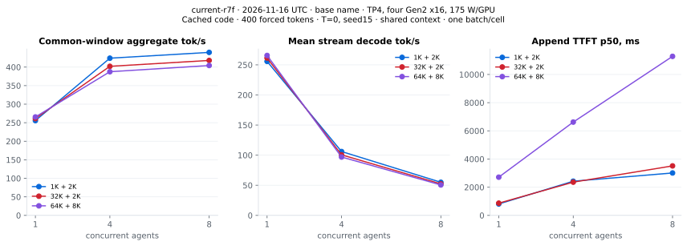

# DeepSeek-V4.1-Flash on four CMP 170HX cards



Serving configuration, image sources, launch settings and benchmarks for DeepSeek-V4.1-Flash-1017 on four NVIDIA CMP 170HX cards.

**Goal.** Run many coding agents from one desktop box. Four-way tensor parallelism fits the model across the GPUs, prefix caching reuses the code agents have already sent, and fair prefill gives long appends and ongoing generations time to run together. The two Engram tables live on NVMe to stay within the host RAM budget.

- **Model.** DeepSeek-V4.1-Flash-1017 with EXL3 EAQ v1.1 routed experts at 2.9 bits per weight. The official checkpoint supplies attention, shared experts, the output head, the DSpark drafter and Engram. [Model and quantization pins](THIRD_PARTY.md)
- **Engine.** Patched vLLM 0.34.0 on four memory-unlocked 64 GB Ampere GPUs. The headline run used PCIe Gen2 x16 and a configured 175 W cap on every card. [Serving plan](config/served.json)
- **Window and KV pool.** Up to 262,144 prompt-plus-output tokens per request, with eight active sequence slots. The FP8 KV pool held 2,483,207 tokens at the 2026-11-20 serving acceptance on the same image with one GPU at x8. [Pool record](config/served.json)
- **Enabled features.** DSpark speculative decoding, prefix caching, fair prefill, images, reasoning and tool calls. The API also exposes separate model names for a rank-one adapter and opt-in sampling policies. [Served configuration](#served-configuration)

## Numbers

The 2026-11-24 UTC headline covers the base model name on `current-r18b`, on one boot with all four cards at x16. Spec-Bench uses 120 prompts and 256 forced output tokens per request. Cached code uses 400 forced output tokens and seed 15. Both use temperature zero. [Results and protocol][headline]


- **Spec-Bench.** One agent produces 137.4 output tok/s over benchmark wall time. Eight reach 291.8 tok/s over wall time, with a 357.5 ms median time to first token. [Spec-Bench results][headline]



- **Cached code.** With a 1K cached prefix and a 2K append, one agent decodes at 250.5 tok/s and eight reach a measured sum of 477.1 tok/s. The highest one-agent decode rate is 260.6 tok/s with a 64K prefix and an 8K append. [Cached-code results][headline]
- **Eight agents at 64K.** With an 8K append per agent, decode runs at 57.0 tok/s per stream and 456.3 tok/s summed. The median first token arrives in 14.00 s. [Cached-code results][headline]

## Quick start

Inspect the exported plan with Python 3.10 or later. It prints the container configuration, model inputs and vLLM arguments without starting Docker.

```sh
bash scripts/serve.sh --print
cp scripts/host.env.example scripts/host.env
# Set the local input directories in scripts/host.env.
bash scripts/serve.sh --check
```

The engine runs on Linux with Docker and the NVIDIA runtime. This source export still requires the authenticated launch and native build inputs. The local launcher reports those prerequisites in `--check` and refuses `--run`. The build recipe, image identity and remaining inputs are in the [reproduction guide](docs/REPRODUCING.md).

## Full results

### Spec-Bench

The 2026-11-24 UTC run used the 120-prompt subset, 256 forced output tokens, temperature zero and the base name on current-r18b. Wall output includes scheduling, prefill, decode and request turnover. Per-stream rate uses median time per output token. [Results][headline]

| Streams | Wall output tok/s | Per-stream tok/s | TTFT p50 / p99 | DSpark acceptance length |
| ---: | ---: | ---: | ---: | ---: |
| 1 | 137.4 | 155.8 | 207.6 / 534.0 ms | 3.10 |
| 4 | 240.0 | 67.0 | 293.6 / 714.2 ms | 2.77 |
| 8 | 291.8 | 39.3 | 357.5 / 882.8 ms | 2.40 |

### Cached code

The 2026-11-24 UTC run used a shared, verified cached prefix, a fresh append per request and one batch per cell. Each request used temperature zero, seed 15 and 400 forced output tokens on current-r18b. Decode sum and mean are measured over the common decode window. [Results][headline]

| Cached prefix + append | Streams | Mean per-stream tok/s | Measured decode sum tok/s | Append TTFT p50 |
| --- | ---: | ---: | ---: | ---: |
| 1K + 2K | 1 | 250.5 | 250.5 | 0.76 s |
| 1K + 2K | 4 | 106.8 | 427.3 | 1.78 s |
| 1K + 2K | 8 | 59.6 | 477.1 | 2.84 s |
| 32K + 2K | 1 | 256.6 | 256.6 | 0.83 s |
| 32K + 2K | 4 | 103.6 | 414.4 | 2.04 s |
| 32K + 2K | 8 | 54.7 | 437.7 | 3.22 s |
| 64K + 8K | 1 | 260.6 | 260.6 | 2.59 s |
| 64K + 8K | 4 | 99.7 | 398.7 | 7.92 s |
| 64K + 8K | 8 | 57.0 | 456.3 | 14.00 s |

## Served configuration

The [parameterized plan](config/served.json) records current-r18b, installed image `sha256:f3027769f90387db0c6f6d0cbd2f05348a8e74023094f9c0d4ec4946d1ea206c`, and seal `seal-nORCnYLm`.

| Item | Setting |
| --- | --- |
| Parallelism | Tensor parallel 4, pipeline parallel 1. Workers use CPUs local to each GPU. |
| Request and cache | 262,144 tokens per request, 8 sequence slots, fixed `fp8_ds_mla` cache with 128-token blocks and an FP8 sparse indexer. GPU memory utilization is configured at 0.98. |
| Scheduling | Async scheduling, prefix caching and a 2,048-token batch budget. Fair prefill caps work for long prefills beside active decoders. A short request can share part of a long prefill's budget, including requests using the adapter. |
| Speculative decode | DSpark drafts up to five tokens. The host verification policy caps uniform decode verification width at three for batches of seven or more. [Policy](config/adaptive-verify.json) |
| GPU execution | Decode CUDA graphs with LoRA specialization disabled, exact bounded indexer, tuned SM80 sparse attention and ring all-reduce. |
| Engram | NVMe-backed row reads with fused dequantization, prefetch and a bounded host row cache. |
| Memory and power | 52 GiB container memory cap with container swap disabled. 175 W configured per card. |
| API | OpenAI-compatible interface with DeepSeek's tokenizer, tool and reasoning parsers. The server preserves prior reasoning and includes request timing and speculation metrics. |

The default API name is `deepseek-v4.1-flash-1017`. The `-abliterated` suffix selects the rank-one adapter per request. The two `-fast` names opt into a separate per-name sampling policy. All headline measurements use the default name.

## What the stack is

The recipe starts from [vLLM 0.34.0](https://github.com/vllm-project/vllm/tree/62d4bc3c7e33b1b6c906e233e6af2d3506c482ca). The image recipe ports the Ampere sparse attention, Engram and EXL3 changes to that release and installs the runtime plugins and native libraries in the image. It keeps the tuned attention table, model view and host policy as separate inputs. The [patch series](docs/PATCHES.md) gives the application order and targets. The [Dockerfile](docker/r18/Dockerfile) describes the build from the pinned Linux image.

The two Engram lookup tables occupy about 203 GB and their rows are read from NVMe as needed. The model's sparse attention, Engram and DSpark are described in the [DeepSeek technical report][report]. The EXL3 integration uses [vllm-exl3][exl3], which remains **AGPL-3.0-only**. [Third-party pins and licences](THIRD_PARTY.md)

## How the numbers are measured

- **Spec-Bench** submits the same 120 stratified prompts at concurrency 1, 4 and 8. Output throughput divides generated tokens by client wall time. The per-stream figure is 1,000 divided by median time per output token in milliseconds. The benchmark supplies no measured decode sum. First-token latency includes client and server request handling. [2026-11-24 notes][headline]
- **Cached code** reuses a warmed code prefix and sends a fresh append. The client checks that every stream hits its cached prefix. The aggregate sums the rates measured in the window when all streams are decoding, and the per-stream column gives their mean. Append TTFT measures from send to first token independently of decode. [2026-11-24 notes][headline]
- **Acceptance length** is one plus accepted draft tokens per draft. The Spec-Bench number describes the workload as measured. Cached code uses one batch per cell, so single-stream peaks are specific to the supplied tasks. Forced outputs measure serving speed without scoring code correctness. [2026-11-24 notes][headline]

## Output checks and caveats

- **GPU and network scope.** The 2026-11-20 acceptance of the r18b image preserved base-name token identity in the mixed-adapter test and confirmed prefix isolation. The adapter's text could vary with neighbouring requests. Those checks ran against the local serving endpoint. [Acceptance and promotion](docs/HISTORY.md)
- **Longer appends.** The 2026-11-24 x16 headline measured higher eight-stream cached-code decode sums than the 2026-11-16 r7f x16 baseline. The eight-stream 64K + 8K append also took longer to reach its first token. Both runs used temperature zero, seed 15 and 400 forced output tokens for cached code. Spec-Bench wall throughput was equal within noise. [Run comparison][headline]
- **Evidence scope.** The retained x16 headline is a summary of the run, with code p99, counters, raw rows and headline memory measurements unavailable. The device power values are configured caps. The [measurement notes][headline] and [instrument guide](docs/GOTCHAS.md) describe the boundaries of the results.

## Other configurations

The [serving history](docs/HISTORY.md) records promotion decisions and links to the previous benchmark sets. Cold prefill changed with the scheduler, so the table below is a historical reference.

| UTC date and source | Configuration and workload | Input tok/s at 1 / 4 / 8 streams |
| --- | --- | --- |
| 2026-11-16 · [loaded suite v2](bench/results/2026-11-16-current-r7e-suite/NOTES.md) | Measured on r7e, not re-measured on r18b. Cold prompts, one output token, temperature zero, thinking off, zero prefix-cache hits and warm host page cache. | 2,048 tokens: 2,946 / 3,340 / 3,648. 8,192 tokens: 3,680 / 3,915 / 3,961. |

## Repository map

| Path | Contents |
| --- | --- |
| [`config/served.json`](config/served.json) and [`scripts/serve.sh`](scripts/serve.sh) | Parameterized current launch plan and prerequisite checks |
| [`docker/r18/`](docker/r18/) and [`docker/overlays/`](docker/overlays/) | Current build recipe and runtime source, plus the archived r7 overlays |
| [`patches/series`](patches/series) and [`docs/PATCHES.md`](docs/PATCHES.md) | Ordered patch inventory, targets and base revisions |
| [`bench/results/`](bench/results/) and [`bench/plot.py`](bench/plot.py) | Dated benchmark evidence and chart generation |
| [`docs/REPRODUCING.md`](docs/REPRODUCING.md) and [`docs/PROVENANCE.md`](docs/PROVENANCE.md) | Reproduction gaps and source receipts |
| [`docs/HISTORY.md`](docs/HISTORY.md) and [`docs/GOTCHAS.md`](docs/GOTCHAS.md) | Serving progression and instrument limits |

Original recipe work uses the [MIT licence](LICENSE). The [third-party credits](THIRD_PARTY.md) and [NOTICE](NOTICE) apply to the included upstream and modified source.

[headline]: bench/results/2026-11-24-current-r18b-headline/
[exl3]: https://github.com/vcruz305/vllm-exl3
[report]: https://huggingface.co/deepseek-ai/DeepSeek-V4.1-Flash/blob/314113f8a7dadb388215396ba5fbee2c610a04d6/DeepSeek_V41_Tech_Report.pdf
