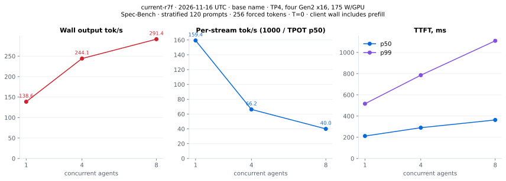

# DeepSeek-V4.1-Flash on 4x CMP 170HX

![Recipe card: Spec-Bench real work, cached-code peaks and parallel agents at 64K depth on four CMP 170HX cards, 2026-11-16][card]

Serving configuration, [patch series][patches], [runtime overlays][overlays] and [measurements][results] for [DeepSeek-V4.1-Flash-1017][model] on four NVIDIA CMP 170HX cards (GA100, `sm_80`, 64 GB each after the memory unlock). The single-socket host uses an EPYC 7401P and NVMe-backed Engram tables. Historical summaries recorded 46 GB host RAM; the current export records the container limit, with host capacity unverified. All four cards use PCIe Gen2 x16 links and a 175 W cap per card. Tensor parallelism spans all four GPUs.

The selected serving definition is **current-r7f**, selected on 2026-11-16 at 18:25 UTC (19:25 Paris). It adds a 52 GiB container memory limit to current-r7e, with identical kernels and model. Current-r7e adds the bitwise eager prefill MoE schedule to r7d. The raw model is `deepseek-v4.1-flash-1017`; the [per-request rank-one adapter][ablit] exposes `deepseek-v4.1-flash-1017-abliterated`. Weights and adapters remain external. Serving is stopped between measurement chains; this is the selected definition, rather than a live-service audit.

The stack combines pinned [vLLM df3bd094][engine], [EXL3 EAQ v1.1 2.9 bpw routed experts][eaq], official FP8/MXFP4 components, [DSpark][dspark] K5, the [fixed640 cooperative kernel][native], the exact bounded indexer with its read-only k1b library, the [single-bank decode MoE stack][moe-stack] and the [workspace-borrowing eager prefill schedule][prefill-code]. The [reproduction guide][reproduce] lists the retained source and model-pin gaps. The [launcher][serve] prints a plan without Docker by default and refuses execution while those gaps remain unresolved.

## Numbers

[headline-begin]: #

Measured 2026-11-16 UTC on **current-r7f**, TP4, four CMP 170HX cards at 175 W per card, EAQ 2.9 bpw routed experts and four PCIe Gen2 x16 links. [Results and protocol](bench/results/2026-11-16-current-r7f-headline/NOTES.md), [numeric records](bench/results/2026-11-16-current-r7f-headline/summary.json). Only `deepseek-v4.1-flash-1017` is timed; the abliterated and opt-in fast names are excluded.

- **Real work:** Spec-Bench frozen 120-prompt subset, 256 forced output tokens, T=0 and all arrivals at once subject to c1/c4/c8. At eight agents: output 291.4 tok/s over benchmark wall, 40.0 tok/s per stream and TTFT p50/p99 363.3 / 1,109.6 ms.
- **Code peaks:** highest measured c1 stream 265.6 tok/s (`code-shared-t65536-a8192-c1`); highest c8 sum 439.7 tok/s (`code-shared-t1024-a2048-c8`). Cached code, 400 forced tokens, T=0 and seed 15; measured common decode window with no interleaved prefill.
- **Parallel agents at depth:** 64K cached code plus an 8K append, eight agents, 400 forced tokens, T=0 and seed 15: 50.5 tok/s each, 404.3 tok/s sum and 11.287 s first token p50. The four-agent row and the 32K+2K companions are below.
- **Dated cold prefill:** 2026-11-16 UTC, r7e suite v2, nominal 2K/8K prompts at c1/c4/c8, one output token, T=0, thinking off, zero prompt-cache hits and warm-steady host page cache. Peak input rate 3,961 tok/s at 8,192 tokens and c8; r7f uses the same kernels. [Fixed-work reference](#loaded-suite-v2-2026-11-16-utc).

### Real agent work

Output rate divides completion tokens by client wall time; per-stream rate is 1000 / TPOT p50. TTFT includes HTTP, scheduling and first decode. Spec-Bench TTFT is not a cold-prefill speed. DSpark acceptance length follows the source recorded per cell.

| streams | output tok/s, wall | per-stream tok/s | TTFT p50 / p99, ms | DSpark acceptance length |
| ---: | ---: | ---: | ---: | ---: |
| 1 | 138.6 | 159.4 | 211.7 / 516.1 | 3.10 |
| 4 | 244.1 | 66.2 | 290.2 / 785.3 | 2.79 |
| 8 | 291.4 | 40.0 | 363.3 / 1,109.6 | 2.45 |

The same calibration also measures all 480 prompts with the same sampler and output length:

| streams | full-480 output tok/s | full-480 per-stream tok/s | TTFT p50 / p99, ms | acceptance length |
| ---: | ---: | ---: | ---: | ---: |
| 1 | 137.9 | 160.2 | 208.6 / 504.6 | 3.09 |
| 4 | 243.1 | 67.2 | 294.7 / 651.5 | 2.80 |
| 8 | 290.1 | 39.0 | 358.7 / 703.6 | 2.43 |

### Cached code matrix

Frozen code tasks reuse a shared cached 1K+2K, 32K+2K or 64K+8K context and append, with 400 forced output tokens, T=0, seed 15 and EOS suppression. Every request confirms prefix residency. The aggregate sums measured stream rates inside the common decode interval; per-stream is their arithmetic mean. Append TTFT describes a separate phase of the same request.

| cached context + append | streams | mean per-stream tok/s | decode sum tok/s | append TTFT p50 / p99, ms |
| --- | ---: | ---: | ---: | ---: |
| 1K + 2K | 1 | 255.7 | 255.7 | 810.6 / 810.6 |
| 1K + 2K | 4 | 106.0 | 424.1 | 2,426.8 / 3,045.5 |
| 1K + 2K | 8 | 55.0 | 439.7 | 3,010.5 / 4,749.8 |
| 32K + 2K | 1 | 261.3 | 261.3 | 868.3 / 868.3 |
| 32K + 2K | 4 | 100.5 | 402.2 | 2,359.4 / 2,942.8 |
| 32K + 2K | 8 | 52.3 | 418.0 | 3,512.9 / 5,409.8 |
| 64K + 8K | 1 | 265.6 | 265.6 | 2,712.6 / 2,712.6 |
| 64K + 8K | 4 | 96.9 | 387.6 | 6,622.2 / 9,885.4 |
| 64K + 8K | 8 | 50.5 | 404.3 | 11,286.6 / 19,581.4 |

Code cells contain one batch per point; p99 over 1, 4 or 8 requests is descriptive. Forced outputs can continue beyond a finished function; no code correctness score is implied.

### Subset calibration

The frozen subset contains 20 prompts in each of six strata. Calibration date: 2026-11-16 UTC, current-r7f. Each 120/480 pair shares a boot; the c1 pair and c4/c8 pairs use separate boots. Routine measurements use one boot and retain the matching calibration. Ratios are subset / full; flags outside 0.98–1.02 are descriptive.

| streams | output ratio | per-stream ratio | TTFT p50 ratio | TTFT p99 ratio | acceptance ratio |
| ---: | ---: | ---: | ---: | ---: | ---: |
| 1 | 1.0053 | 0.9945 | 1.0150 | 1.0227 FLAG | 1.0059 |
| 4 | 1.0040 | 0.9853 | 0.9845 | 1.2054 FLAG | 0.9936 |
| 8 | 1.0045 | 1.0245 FLAG | 1.0129 | 1.5769 FLAG | 1.0083 |

[headline-end]: #

## Served configuration

| item | current-r7f |
| --- | --- |
| runtime | [vLLM][vllm] [df3bd094aeea829f27baa0a5282830464f601d9f][engine], installed image ID `sha256:f760136967d6c4cac9f4de317e2b9a19a170d27519ddeb0ba9aad3e420ec3c27` |
| weights | [EAQ v1.1 EXL3 2.9 bpw routed experts][eaq]; [official attention, shared experts, head, draft and Engram components][model] |
| parallelism | TP4, PP1; four CMP 170HX cards |
| power and bus | 175 W per GPU; PCIe Gen2 x16 on each GPU |
| Engram | NVMe row reads, [fused dequantization, early prefetch and bounded host row cache][engram] |
| request window | 262,144 tokens configured |
| scheduling | eight sequences; 2,048 batched tokens; async scheduling and prefix caching |
| graphs | FULL_DECODE_ONLY; capture sizes every integer from 1 through 48; LoRA specialization disabled |
| speculation | [DSpark][dspark] maximum five draft tokens; adaptive verification disabled; [calibrated row-mask features][depth] only through batch one |
| KV | `fp8_ds_mla`; FP8 indexer |
| attention | [tuned BF16x2 split-K table][splitk], [fused SWA metadata and top-k glue][attention]; exact bounded indexer top-k enabled |
| communication | true ring at the [r7 row list][served-plan]; existing INT8 prefill reduction; [replicated Engram wkv][wkv] |
| MoE | [fused dispatch preparation][dispatch], [fixed640 native cooperative kernel][native] and [rows-family kernels for 24 row counts plus K2 fixed16][moe-stack]; STACK only during eligible target decode graph capture, single bank; [bitwise 7b eager prefill schedule][prefill-code] at 128–2,048 rows, borrowed incumbent workspace, decode graph path retained |
| API | DeepSeek tokenizer, tool and reasoning parsers; raw default plus the [per-request abliterated name][ablit] |
| chat | earlier reasoning preserved with `drop_thinking=false`; image count limit 999 |
| container memory | `--memory=55834574848 --memory-swap=55834574848`: 52 GiB, container swap disabled |
| host | GPU workers pinned to their card's local CPUs; engine/API affinity retained |
| other policies | fair prefill and prompt lookup disabled; client sampling defaults unchanged |

## What the stack is

The base r17 image kit supplies SM80 sparse attention, SSD Engram storage, [ExLlamaV3][exl3] integration through [vllm-exl3][vllm-exl3] and tensor-core prefill support on the pinned nightly. The installed f760 image contains later layers; rebuilding the r17 kit alone does not reproduce it. The [ordered patch documentation][patches] gives each exported patch's purpose, target and base, with links into [`patches/vllm/`][vllm-patches], [`patches/vllm-exl3/`][exl3-patches], [`patches/native/`][native], [`patches/engram/`][engram] and [`patches/splitk/`][splitk]. **vllm-exl3 is AGPL-3.0-only**; its [licence][agpl], [NOTICE][notice] and [third-party notices][third-party] apply to the modified integration.

The runtime adds the [split-K precision table][splitk], [cap-1 depth bridge][depth], [target][target-argmax] and [draft sharded argmax][draft-argmax], [attention metadata fusions][attention], [lean row statistics][rowstats], [replicated wkv][wkv], [fused dispatch][dispatch] and expanded true-ring rows. The [r7a plugin][ablit] binds the dense rank-one update per request. R7b supplies the [fixed640 native series][native]; r7c adds exact bounded indexer top-k with the read-only k1b native library. R7d adds the [single-bank MoE stack][moe-stack], retaining the incumbent graph descriptor set and eager functions outside eligible capture forwards. R7e adds the bitwise eager prefill schedule with its borrowed workspace, native-profile identity check, capture fences and fixed boot switch. R7f raises only the container memory and memory-swap values from 36 to 52 GiB. The bounded plugin, measured STACK/7b native bundles and native baseline remain explicit [source gaps][reproduce]. The [source inventory][inventory] records exported hashes; [provenance][provenance] and [third-party inputs][third-party] record their origins and unresolved pins.

The model's DSpark, sparse attention and Engram components are described in the [DeepSeek-V4.1 technical report][report] and [official inference source][dspark]. The [sibling Qwen3.8-Flash-Next recipe for two CMP 170HX cards][qwen-cmp] records the same card family on a different model and serving stack.

## Loaded suite v2, 2026-11-16 UTC

Loaded suite v2 remains the dated reference for fixed-work comparisons. The same-hour r7d/r7e run was measured on 2026-11-16 at 11:04–11:35 UTC, run `20261116T110411Z-1955810-suite-r7e`: one boot per definition, TP4, four Gen2 x16 links at 175 W per card. R7f changes only the memory cap; these are measurements of r7e. [Results and protocol](bench/results/2026-11-16-current-r7e-suite/NOTES.md), [summary](bench/results/2026-11-16-current-r7e-suite/summary.json).

Decode uses frozen `decode-prompts-v2` chat prompts, mostly reasoning prose before code, 400 output tokens per request, temperature zero, seed 15 and EOS suppression. Each batch sums measured request decode rates, `(completion_tokens - 1) / (stream_end - first_content_event)`, then the boot averages scored batches. Individual stream statistics and shared-overlap-window decode are unavailable in this suite summary.

| streams / protocol | r7e decode aggregate, tok/s | r7d same-hour reference | r7e step, ms |
| --- | ---: | ---: | ---: |
| 1 ordered | 166.9 | 168.0 | 18.82 |
| 4 ordered | 370.1 | 370.5 | 32.16 |
| 8 burst | 456.7 | 454.3 | 44.69 |

Prefill uses nominal 2K/8K prompts, one output token, temperature zero, thinking off, zero prompt-cache hits and warm-steady host page cache. These are suite-v2 input rates, separate from the headline append TTFT measurement.

| nominal prompt tokens | streams | r7e input tok/s | r7d same-hour reference |
| ---: | ---: | ---: | ---: |
| 2,048 | 1 | 2,946 | 2,800 |
| 2,048 | 4 | 3,340 | 3,176 |
| 2,048 | 8 | 3,648 | 3,413 |
| 8,192 | 1 | 3,680 | 3,485 |
| 8,192 | 4 | 3,915 | 3,676 |
| 8,192 | 8 | 3,961 | 3,698 |

Both boots completed with identity and KV checks passing. The chain report failed its same-hour-window check despite the recorded 31-minute duration; these values were transcribed from the retained per-boot summary table. The notes preserve that limitation. Suite boot-to-boot noise limits attribution of the small decode changes.

## Reproducing

Start with [the reproduction guide][reproduce], [host environment example][host-env], [serving plan][served-plan] and [launcher][serve]. `bash scripts/serve.sh --print` renders the local plan. A complete Linux image build, native compile and GPU acceptance have not been run for this export. The source package still needs the listed runtime assets and full checkpoint/adapter provenance before it can reproduce a serving boot.

## Measurement limits

Earlier Spec-Bench pass A on r7d does not describe current TTFT or wall output because r7e changed prefill. Earlier measurements remain in the [history][history] and dated [results][results]. The headline protocol covers the base served name only. It does not establish sampled agent performance at temperature one, fast-name speed, abliterated-model speed, public benchmark accuracy, maximum KV capacity, memory-category use or wall power.

R7e actual-launcher acceptance passed on 2026-11-16 at 08:33–08:48 UTC, run `20261116T083315Z-760421-actual-acceptance`. R7f acceptance passed at 18:08–18:22 UTC, run `20261116T180842Z-1157942-actual-acceptance`: both-name identity before and after work, the exact memory pair, KV and client contracts passed; the report-only suite was skipped for lack of time. Serving remained absent after teardown. Loopback checks do not establish client-network reachability. Correctable PCIe errors remain a hardware caveat. [History][history].

Original recipe work uses [MIT][license]; third-party components retain the notices in [NOTICE][notice] and [THIRD_PARTY.md][third-party].

[model]: https://huggingface.co/deepseek-ai/DeepSeek-V4.1-Flash-1017
[vllm]: https://github.com/vllm-project/vllm
[engine]: https://github.com/vllm-project/vllm/commit/df3bd094aeea829f27baa0a5282830464f601d9f
[exl3]: https://github.com/turboderp-org/exllamav3
[vllm-exl3]: https://github.com/vcruz305/vllm-exl3
[eaq]: https://huggingface.co/Mia-AiLab/DeepSeek-V4.1-Flash-1017-EXL3-EAQ-v1.1-2.9-bpw
[dspark]: https://huggingface.co/deepseek-ai/DeepSeek-V4.1-Flash-1017/blob/1bae0e1088993b9b82de08f59de5be5a34e42170/inference/model.py#L1022
[report]: https://huggingface.co/deepseek-ai/DeepSeek-V4.1-Flash/blob/314113f8a7dadb388215396ba5fbee2c610a04d6/DeepSeek_V41_Tech_Report.pdf
[qwen-cmp]: https://github.com/adrienbrault/qwen3.8-flash-next-2x-cmp170hx
[decode-chart]: docs/img/decode-concurrency.svg
[history-chart]: docs/img/history.svg
[qualification]: bench/results/2026-11-15-current-r7d-qualification/NOTES.md
[summary]: bench/results/2026-11-15-current-r7d-qualification/summary.json
[qualification-dir]: bench/results/2026-11-15-current-r7d-qualification/
[results]: bench/results/
[history]: docs/HISTORY.md
[gotchas]: docs/GOTCHAS.md
[reproduce]: docs/REPRODUCING.md
[third-party]: THIRD_PARTY.md
[notice]: NOTICE
[license]: LICENSE
[agpl]: licenses/vllm-exl3-AGPL-3.0-only.txt
[provenance]: docs/PROVENANCE.md
[inventory]: docs/SOURCE-INVENTORY.json
[patches]: docs/PATCHES.md
[overlays]: docker/overlays/
[vllm-patches]: patches/vllm/
[exl3-patches]: patches/vllm-exl3/
[native]: patches/native/
[engram]: patches/engram/
[splitk]: patches/splitk/
[depth]: docker/overlays/dsv41_depth/
[target-argmax]: docker/overlays/dsv41_lora_argmax/
[draft-argmax]: docker/overlays/dsv41_draft_argmax/
[attention]: docker/overlays/dsv41_attn_port/
[rowstats]: docker/overlays/dsv41_rowstats/
[wkv]: docker/overlays/dsv41_wkv_replica/
[dispatch]: docker/overlays/dsv41_dispatch_fuse/
[ablit]: docker/overlays/dsv41_ablit_r7/
[serve]: scripts/serve.sh
[host-env]: scripts/host.env.example
[served-plan]: config/served.json
[plot]: bench/plot.py
[moe-stack]: docker/overlays/dsv41_moe_stack/
[prefill-code]: docker/overlays/prefill-code/
[card]: docs/img/recipe-card-43b6da23.png
