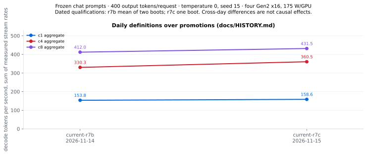

# Serving history

The table records changes of the daily definition. A selected definition can remain stopped. The numeric history figure uses only the dated summaries available in this repository; earlier entries without November suite summaries are omitted.

| UTC date | definition | change and evidence |
| --- | --- | --- |
| 2026-10-21 | initial preparation | [Historical measurements](../bench/results/); the original README had no serving definition. Those rates do not describe the November stack. |
| 2026-11-10 | current-r6 | Attention, draft argmax, row statistics, replicated wkv, fused dispatch and extended true-ring rows; hardware links returned to four Gen2 x16 links. No numeric summary exported for this promotion. |
| 2026-11-13 | current-r7 | Expanded true-ring row list; source `rounds/stack-r2/out/20261112T192726Z-3009517-r7-equiv-speed`. Fair prefill removed. No numeric summary exported for this promotion. |
| 2026-11-13 | current-r7a | Per-request rank-one abliterated adapter, fused dense update and GPU-local worker CPU affinity. No numeric summary exported for this promotion. |
| 2026-11-14 09:45 | current-r7b | [Fixed640 native series](../patches/native/); [qualification](../bench/results/2026-11-14-current-r7b-qualification/), source `20261114T052150Z-2097332-qualify`; acceptance `20261114T092653Z-4010770-actual-acceptance`. Promotion minute follows the retained current operating record. |
| 2026-11-15 19:45 | current-r7c | Exact bounded indexer top-k on r7b, read-only k1b library; [confirmation and acceptance](../bench/results/2026-11-15-current-r7c-qualification/). Serving absent after acceptance teardown. |
| 2026-11-16 00:00 | current-r7d | Rows-family kernels for 24 row counts plus K2 fixed16, single-bank capture-only MoE plugin; [confirmation and acceptance](../bench/results/2026-11-15-current-r7d-qualification/). Serving remains stopped. |
| 2026-11-16 09:08 | current-r7e | Bitwise eager prefill MoE schedule at 128–2,048 rows, borrowed workspace; acceptance `20261116T083315Z-760421-actual-acceptance` PASS, serving stopped. [Same-hour suite](../bench/results/2026-11-16-current-r7e-suite/). |
| 2026-11-16 18:25 | current-r7f | Container memory and memory-swap 36 -> 52 GiB, same kernels/model; acceptance `20261116T180842Z-1157942-actual-acceptance` PASS at 18:08–18:22 UTC, identity before/after, KV and client contracts PASS; report-only suite SKIPPED. Selected, serving stopped. |

## Current-r7b qualification, 2026-11-14

The [qualification notes](../bench/results/2026-11-14-current-r7b-qualification/NOTES.md) and [summary](../bench/results/2026-11-14-current-r7b-qualification/summary.json) retain the two ON boots measured on 2026-11-14 05:21–07:02 UTC, results directory `rounds/current-r7b-r1/out/20261114T052150Z-2097332-qualify`. The configuration used TP4, four Gen2 x16 links, 175 W per card, DSpark K5 and the fixed640 cooperative kernel. Decode used frozen `decode-prompts-v2` chat prompts, mostly reasoning prose before code, temperature zero, seed 15, EOS suppression and 400 output tokens per request. Each batch summed measured request decode rates, each boot averaged its scored batches, then the published row averaged the two boot means.

| concurrency | decode aggregate mean, tok/s | ON boot rates, tok/s |
| ---: | ---: | --- |
| 1 | 153.8 | 154.35 / 153.20 |
| 4 | 330.3 | 334.66 / 325.98 |
| 8 | 412.0 | 415.56 / 408.43 |

| nominal cold input tokens per request | concurrency | TTFT, s | aggregate input rate, tok/s |
| --- | ---: | ---: | ---: |
| 2,048 | 1 | 0.749 | 2,738 |
| 2,048 | 4 | 2.187 | 3,113 |
| 2,048 | 8 | 3.297 | 3,352 |
| 8,192 | 1 | 2.355 | 3,480 |
| 8,192 | 4 | 6.103 | 3,629 |
| 8,192 | 8 | 10.476 | 3,686 |

Prefill used the same qualification and r7b configuration: temperature zero, thinking off, EOS suppression, one output token, zero prompt-cache hits, warm-steady host page cache, one unscored warm batch and three scored batches per point. Each boot took the median of b0–b2, then the row averaged the two ON boot statistics. Input rate and TTFT were transcribed separately; nominal text lengths precede the chat template. Full qualification records are absent locally. [Conditions](../bench/results/2026-11-14-current-r7b-qualification/NOTES.md).

Actual-launcher acceptance passed on 2026-11-14 09:26–09:37 UTC. It checked both served names and token identity against the four qualification boots. The operating record reports matching logprob bits and shapes for this acceptance; the gate itself checked token identity because raw c8 has an incumbent bimodal case. The [partial per-operation profile](../bench/results/2026-11-14-current-r7b-profile/NOTES.md), measured separately on 2026-11-14 at forced c4 K3 / c8 K2 / c1 K5 shapes, remains diagnostic evidence from another boot.

## Current-r7c confirmation, 2026-11-15

The [confirmation notes](../bench/results/2026-11-15-current-r7c-qualification/NOTES.md) retain the same-chain r7b OFF controls, the single r7c ON boot and the separate acceptance receipt. The [summary](../bench/results/2026-11-15-current-r7c-qualification/summary.json) is the figure source. The r7b OFF rates on 2026-11-15 differ from its earlier qualification; only the same-chain OFF/ON/OFF comparison supports attribution to the bounded indexer. The two-day promotion chart is a record of dated qualifications, not a controlled causal comparison.

The former PCIe Gen2 x4 README statement belongs to older hardware state. The current definition records four x16 links at 5 GT/s and 175 W per card. Correctable PCIe errors and replays remain a hardware caveat. Earlier x8 or x4 results retain their original labels. No r7c memory-category summary is available for a memory chart.

## Current-r7d confirmation, 2026-11-15

The [confirmation notes](../bench/results/2026-11-15-current-r7d-qualification/NOTES.md) and [summary](../bench/results/2026-11-15-current-r7d-qualification/summary.json) record the one-ON run `20261115T214428Z-3587331-moe-stack-confirm` on 2026-11-15 21:44–22:02 UTC, against the stored same-day r7c reference. Loaded suite v2, frozen chat, 400 output tokens per request, temperature zero, seed 15, EOS suppression, TP4 and four Gen2 x16 cards at 175 W each: c1 168.2 and c4 369.9 tok/s ordered, c8 457.5 tok/s burst, with ordered c8 419.7 tok/s. The final plugin keeps STACK inside eligible target capture forwards and restores incumbent eager entrypoints. BITWISE_PASS and actual-launcher acceptance are retained records, not tests repeated by this mirror.

Absolute r7d prefill is omitted because host drift invalidates a clean same-config comparison. The 2026-11-16 same-hour prefill control reported +2 to +6 % against r7c; the linked notes identify the 2K/8K c1/c4/c8 workload, sampler and two diagnostic runs. R7c absolute prefill and its dated [figure](img/prefill.svg) remain historical. The history chart includes all three dated qualification summaries; protocols and cross-boot differences limit causal interpretation.

## Current-r7e and current-r7f, 2026-11-16

R7e folds the measured eager-only 7b schedule into r7d. The workspace-borrowing adapter retains the incumbent decode bank and arithmetic, authenticates native output bytes during profile, and fences graph capture/replay and eager execution. The [same-hour suite notes](../bench/results/2026-11-16-current-r7e-suite/NOTES.md) retain the dated r7d/r7e comparison and report-window failure. The new agent/peak/long-context headline calibration remains pending.

R7f changes the two container creation limits to 55,834,574,848 bytes, with memory-swap equal to memory. It adds no kernel or model change. The acceptance skipped its report-only suite because the remaining window was too short; no new speed number is attributed to that acceptance. Selection was recorded at 19:25 Paris (18:25 UTC), without restoring serving. Host RAM is not inferred from the container cap.
